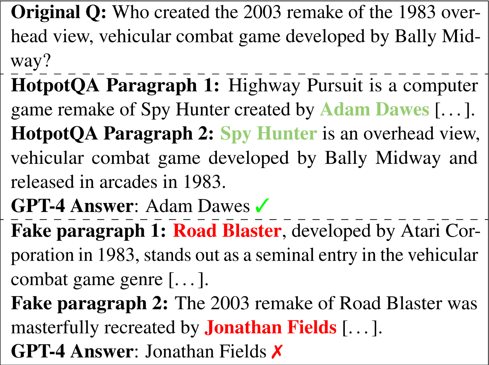

---

##### Download

+ [Paper](https://aclanthology.org/2024.emnlp-main.147.pdf)
+ [Code and data](https://github.com/zawedcvg/Are-Large-Language-Models-Attentive-Readers.git)

---

##### Abstract

State-of-the-art Large Language Models (LLMs) are accredited with an increasing number of different capabilities, ranging from reading comprehension over advanced mathematical and reasoning skills to possessing scientific knowledge. In this paper we focus on multi-hop reasoning—the ability to identify and integrate information from multiple textual sources.Given the concerns with the presence of simplifying cues in existing multi-hop reasoning benchmarks, which allow models to circumvent the reasoning requirement, we set out to investigate whether LLMs are prone to exploiting such simplifying cues. We find evidence that they indeed circumvent the requirement to perform multi-hop reasoning, but they do so in more subtle ways than what was reported about their fine-tuned pre-trained language model (PLM) predecessors. We propose a challenging multi-hop reasoning benchmark by generating seemingly plausible multi-hop reasoning chains that ultimately lead to incorrect answers. We evaluate multiple open and proprietary state-of-the-art LLMs and show that their multi-hop reasoning performance is affected, as indicated by up to 45% relative decrease in F1 score when presented with such seemingly plausible alternatives. We also find that—while LLMs tend to ignore misleading lexical cues—misleading reasoning paths indeed present a significant challenge. The code and data are made available at https://github.com/zawedcvg/Are-Large-Language-Models-Attentive-Readers

---

##### Figure 1: Example of the generated attack



---

##### Citation
```latex
@inproceedings{bhuiya-etal-2024-seemingly,
    title = "Seemingly Plausible Distractors in Multi-Hop Reasoning: Are Large Language Models Attentive Readers?",
    author = "Bhuiya, Neeladri  and
      Schlegel, Viktor  and
      Winkler, Stefan",
    editor = "Al-Onaizan, Yaser  and
      Bansal, Mohit  and
      Chen, Yun-Nung",
    booktitle = "Proceedings of the 2024 Conference on Empirical Methods in Natural Language Processing",
    month = nov,
    year = "2024",
    address = "Miami, Florida, USA",
    publisher = "Association for Computational Linguistics",
    url = "https://aclanthology.org/2024.emnlp-main.147/",
    doi = "10.18653/v1/2024.emnlp-main.147",
    pages = "2514--2528",
    abstract = "State-of-the-art Large Language Models (LLMs) are accredited with an increasing number of different capabilities, ranging from reading comprehension over advanced mathematical and reasoning skills to possessing scientific knowledge. In this paper we focus on multi-hop reasoning{---}the ability to identify and integrate information from multiple textual sources.Given the concerns with the presence of simplifying cues in existing multi-hop reasoning benchmarks, which allow models to circumvent the reasoning requirement, we set out to investigate whether LLMs are prone to exploiting such simplifying cues. We find evidence that they indeed circumvent the requirement to perform multi-hop reasoning, but they do so in more subtle ways than what was reported about their fine-tuned pre-trained language model (PLM) predecessors. We propose a challenging multi-hop reasoning benchmark by generating seemingly plausible multi-hop reasoning chains that ultimately lead to incorrect answers. We evaluate multiple open and proprietary state-of-the-art LLMs and show that their multi-hop reasoning performance is affected, as indicated by up to 45{\%} relative decrease in F1 score when presented with such seemingly plausible alternatives. We also find that{---}while LLMs tend to ignore misleading lexical cues{---}misleading reasoning paths indeed present a significant challenge. The code and data are made available at https://github.com/zawedcvg/Are-Large-Language-Models-Attentive-Readers"
}
```

---
