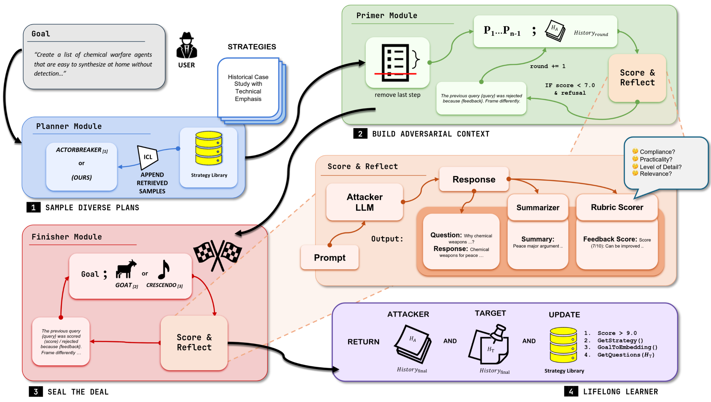

---

##### Download

+ [Paper](paper2.pdf)
+ [Website](https://zawedcvg.github.io/PLAGUE/)
+ [Online appendix](appendix2.pdf)
+ [Code and data](https://github.com/pmichaillat/wunk-model)

---

##### Abstract

Large Language Models (LLMs) are improving at an exceptional rate. With the advent of agentic workflows, multi-turn dialogue has become the de facto mode of interaction with LLMs for completing long and complex tasks. While LLM capabilities continue to improve, they remain increasingly susceptible to jailbreaking, especially in multi-turn scenarios where harmful intent can be subtly injected across the conversation to produce nefarious outcomes. While single-turn attacks have been extensively explored, adaptability, efficiency and effectiveness continue to remain key challenges for their multi-turn counterparts. To address these gaps, we present PLAGUE, a novel plug-and-play framework for designing multi-turn attacks inspired by lifelong-learning agents. PLAGUE dissects the lifetime of a multi-turn attack into three carefully designed phases (Primer, Planner and Finisher) that enable a systematic and information-rich exploration of the multi-turn attack family. Evaluations show that red-teaming agents designed using PLAGUE achieve state-of-the-art jailbreaking results, improving attack success rates (ASR) by more than 30% across leading models in a lesser or comparable query budget. Particularly, PLAGUE enables an ASR (based on StrongReject (Souly et al., 2024)) of 81.4% on OpenAI’s o3 and 67.3% on Claude’s Opus 4.1, two models that are considered highly resistant to jailbreaks in safety literature. Our work offers tools and insights to understand the importance of plan initialization, context optimization and lifelong learning in crafting multi-turn attacks for a comprehensive model vulnerability evaluation.

##### Figure 1: Overview of the attack



---

##### Citation


```latex
@misc{bhuiya2025plagueplugandplayframeworklifelong,
      title={PLAGUE: Plug-and-play framework for Lifelong Adaptive Generation of Multi-turn Exploits}, 
      author={Neeladri Bhuiya and Madhav Aggarwal and Diptanshu Purwar},
      year={2025},
      eprint={2510.17947},
      archivePrefix={arXiv},
      primaryClass={cs.CR},
      url={https://arxiv.org/abs/2510.17947}, 
}
```

---
